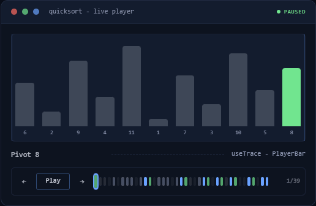

<div align="center">

# stepwise

**Interactive explainers for React: step-through players, guided tours, scroll-driven lessons and glossary tooltips, all on one cursor.**

[](https://www.npmjs.com/package/@sphynxoid/stepwise)
[](https://bundlephobia.com/package/@sphynxoid/stepwise)
[](https://github.com/TheSphynxoid/stepwise/actions/workflows/ci.yml)
[](LICENSE)

[**Live demos**](https://stepwise.thesphynx.net) · [API reference](https://stepwise.thesphynx.net/docs) · [Try it on StackBlitz](https://stackblitz.com/github/TheSphynxoid/stepwise/tree/master/examples/vite-starter)



</div>

## Why

You want to *show* how something works: an algorithm, a protocol, a pipeline,
your product's new feature. Today that means gluing together a tour library,
a scrollytelling library, a hand-rolled play/pause/scrub player, and
tooltips, each with its own state model, and then keeping them in sync.

stepwise starts from one observation: **frames in a trace, steps in a tour
and chapters in a lesson are all the same thing**, a clamped cursor over an
ordered sequence. So there is one primitive (`useSteps`) and a few policies
on top of it:

| You're building | Use | You get |
|---|---|---|
| An algorithm or protocol walkthrough | `useTrace` + `PlayerBar` | play/pause/scrub, speed, keyboard, `#frame=12` deep links, reduced-motion aware autoplay, a scrubber colored by step tone |
| An explainer the reader can poke at | `useSimulation` | the trace is computed from an input; edit it mid-playback and the playhead stays on the same step; seeded randomness, so links replay exactly |
| A live feed: logs, streams, agent steps | `useTrace({ follow })` + `PlayerBar live` | new frames play in while you watch; scrub back to inspect one and the stream doesn't yank you away; "Go live" returns |
| "Pause and predict" exercises | `holdAt` checkpoints + `useEvaluator` | autoplay stops where you choose; grade the reader's guess with feedback, async checks, attempt counts |
| A side-by-side comparison | `useSyncedTracks` | N traces under one playhead, aligned on shared sync points |
| A product tour / onboarding | `useGuidedTour` + `TourSpotlight` + `TourCard` | steps that *change app state* (`onEnter`), gates that wait for the user to actually do the thing, branches, skip conditions |
| A show-once feature tutorial | `useDiscoveries` + a tour | a persisted "seen it" ledger (localStorage, cookie, or your API) |
| A long-form scroll lesson | `useChapters` + `ChapterNav` | viewport-center chapter tracking, nested chapters, progress |
| Jargon-heavy prose | `Term` + `GlossaryAppendix` | recursive definition tooltips and an auto-built appendix |

Because they share one cursor they compose: [the flagship lesson demo](https://stepwise.thesphynx.net/lesson)
is a scroll lesson whose chapters seek an embedded Dijkstra player, with a
guided tour over the top, and every cursor shown live.

## 30-second start

```bash
npm install @sphynxoid/stepwise
```

```tsx
"use client";
import { createTrace, useTrace, PlayerBar } from "@sphynxoid/stepwise";
import "@sphynxoid/stepwise/styles.css"; // skip this if you use Tailwind; see "Styling"

// Build the trace once, at module scope. Your own data rides along on each frame.
const frames = createTrace<{ arr: number[] }>()
  .step({ tone: "neutral", label: "Start", arr: [3, 1, 2] })
  .step({ tone: "write", label: "Swap 3 and 1", arr: [1, 3, 2] })
  .step({ tone: "write", label: "Swap 3 and 2", arr: [1, 2, 3] })
  .step({ tone: "good", label: "Sorted", arr: [1, 2, 3] })
  .build();

export function SortDemo() {
  const { step, player, toneAt, titleAt } = useTrace(frames, { autoPlay: true, syncHash: "frame" });
  return (
    <figure>
      <p>{step!.arr.join(" ")}: {step!.label}</p>
      <PlayerBar player={player} toneAt={toneAt} titleAt={titleAt} />
    </figure>
  );
}
```

How you draw each frame is up to you: DOM, SVG, canvas, or GSAP via the
`PlayerEngine` adapter. stepwise owns the *timeline*, not the pixels.

## Live simulations: let the reader change the input

Instead of recording frames by hand, write the algorithm as a generator and
give each step a `key` naming its moment. `useSimulation` reruns it whenever
the input changes, and the playhead stays on the same moment, even mid-playback
([try it](https://stepwise.thesphynx.net/simulate)):

```tsx
const insertionSort = function* (input: number[]) {
  const a = [...input];
  for (let i = 1; i < a.length; i++)
    for (let j = i; j > 0 && a[j - 1] > a[j]; j--) {
      [a[j - 1], a[j]] = [a[j], a[j - 1]];
      yield { key: `swap ${i}.${j}`, tone: "write" as const, label: `swap at ${j}`, arr: [...a] };
    }
};

function Explorer() {
  const [input, setInput] = useState([5, 2, 8, 1]);
  const sim = useSimulation(insertionSort, input, { autoPlay: true });
  // render sim.step.arr, let the reader edit `input`, add <PlayerBar player={sim.player} … />
}
```

Need randomness? Use the seeded `ctx.rng` the generator receives, never
`Math.random`, and the same input plus seed always gives the same trace.
Add `syncInput` to put the input in the URL so links replay the exact run,
`holdAt` to pause at checkpoints, and `useEvaluator` to grade a guess.

## How it compares

stepwise isn't a drop-in replacement for any single tool below. Its point is
that one model covers the whole set. Choose honestly:

| | Step player | Product tour | Scroll chapters | Glossary | Composes |
|---|:-:|:-:|:-:|:-:|:-:|
| **stepwise** | ✅ | ✅ | ✅ | ✅ | ✅ one cursor |
| react-joyride / Shepherd / driver.js | – | ✅ | – | – | – |
| scrollama / react-scrollama | – | – | ✅ | – | – |
| Motion Canvas / Remotion | renders video | – | – | – | – |

- **Only need a tour?** react-joyride and Shepherd are mature, with years of
  edge cases handled. stepwise's tour wins when steps must mutate app state
  or wait on real user actions (`onEnter`, `gate`), or when it shares a page
  with a player. It can also *present* through driver.js via the adapter.
- **Only need scroll triggers?** scrollama is tiny and framework-agnostic.
- **Want a video?** Motion Canvas and Remotion render one. stepwise is for
  explainers the reader drives: pause, scrub, deep-link to a frame.

## Styling

The hooks are headless. The optional components (`PlayerBar`, `TourCard`,
`Term`, …) can be styled three ways:

| Your app | Do this |
|---|---|
| **No Tailwind** | `import "@sphynxoid/stepwise/styles.css";` once: precompiled, light/dark, themable via `--stepwise-*` variables |
| **Tailwind + shadcn/ui** | `npx shadcn@latest add https://stepwise.thesphynx.net/r/player-bar.json` copies the component source into your repo (hooks stay on npm) |
| **Tailwind, components from npm** | add `@source "../node_modules/@sphynxoid/stepwise/dist";` to your CSS entry |

Details and the "everything renders unstyled" checklist: [`docs/TAILWIND-SETUP.md`](docs/TAILWIND-SETUP.md).

## Good to know

- **React 18 and 19**, SSR-safe (`"use client"` modules, no `window` at import), tested in Next.js (App Router) and Vite.
- **Small dependency surface**: React plus `clsx`/`tailwind-merge`. GSAP and driver.js integrations are optional subpath imports.
- **Accessible by default**: keyboard control, focus-trapped tour card, ARIA slider scrubber, `prefers-reduced-motion` respected.
- **Works with AI assistants**: the package ships [`LLMS.md`](packages/stepwise/LLMS.md), and the site serves [`/llms.txt`](https://stepwise.thesphynx.net/llms.txt) and [`/llms-full.txt`](https://stepwise.thesphynx.net/llms-full.txt), so an assistant that has never seen stepwise can read the patterns and pitfalls instead of guessing.
- **ESM only.**
- **Pre-1.0**: the API may still change between minor versions. Breaking changes are listed in the [CHANGELOG](CHANGELOG.md). Feedback on the API is the most useful thing you can send right now.

## Repository

- `packages/stepwise`: the library ([package README](packages/stepwise/README.md) has the full API tour)
- `apps/demo`: the demo site (Next.js); every page has a "View source" panel showing its real code
- `examples/vite-starter`: the smallest real app, installed from npm
- [`examples/next-mdx`](examples/next-mdx): an interactive article in Next.js + MDX (editable player, predict mode, glossary)
- [`docs/RECIPES.md`](docs/RECIPES.md): Next.js + MDX, shareable links, grading a checkpoint, testing
- [`docs/ARCHITECTURE.md`](docs/ARCHITECTURE.md): the layering, ports/adapters, and the algorithms with the reasoning behind each
- [`AGENTS.md`](AGENTS.md): the contributor's operating manual (commands, invariants, gotchas)

```bash
npm install
npm run demo      # builds the library, starts the demo
npm run test      # unit tests (or: cd packages/stepwise && npx vitest run)
```

Contributions welcome. Start with [CONTRIBUTING.md](CONTRIBUTING.md).

## License

MIT
