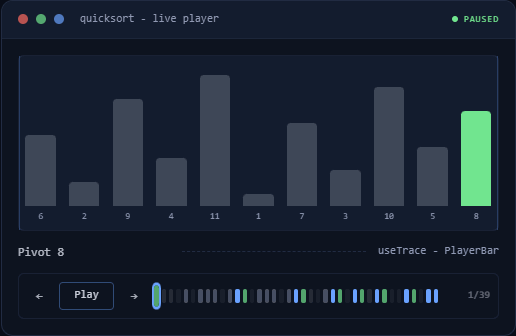

# @sphynxoid/stepwise

**Interactive explainers for React: step-through players, guided tours, scroll-driven lessons and glossary tooltips, all on one cursor.**

**[Live demos](https://stepwise.thesphynx.net)** · [API reference](https://stepwise.thesphynx.net/docs) · [StackBlitz starter](https://stackblitz.com/github/TheSphynxoid/stepwise/tree/master/examples/vite-starter) · [GitHub](https://github.com/TheSphynxoid/stepwise)



Frames in a trace, chapters in a lesson, lessons in a notebook, and tour steps are the same thing at the core: a clamped cursor over an ordered sequence. Timers, tour effects, scroll tracking, and third-party presenters are policies and adapters layered on top.

- **Headless core.** The hooks never render; the styled components are optional and theme-injectable.
- **One dependency by default.** The root barrel needs only React. GSAP and driver.js integrations are opt-in via adapter subpaths.

## Install

```bash
npm install @sphynxoid/stepwise
```

Optional adapters (install only what you use):

```bash
npm install gsap        # @sphynxoid/stepwise/adapters/gsap
npm install driver.js   # @sphynxoid/stepwise/adapters/driver-js
# @sphynxoid/stepwise/adapters/scroll is dependency-free
```

## Styling — pick one

The hooks are headless. The styled components (`PlayerBar`, `TourCard`, `Term`, …) ship Tailwind class strings, and there are three ways to get them styled:

**1. No Tailwind — import the precompiled stylesheet** (once, at your app entry):

```ts
import "@sphynxoid/stepwise/styles.css";
```

It contains exactly the CSS the components use, no global reset (a small preflight is scoped to the components' `[data-stepwise]` roots), and light/dark defaults that follow `prefers-color-scheme` or a `.dark` / `[data-theme="dark"]` switch. Re-color it with CSS variables:

```css
:root {
  --stepwise-primary: #7c3aed;      /* play button, active segment, rings */
  --stepwise-accent: #0ea5e9;       /* "accent" tone, links, wait hints */
}
```

Tokens: `--stepwise-background`, `-foreground`, `-card`, `-popover`, `-primary`, `-primary-foreground`, `-accent`, `-destructive`, `-ring`, `-shade` (overlay/code-block tint).

**2. Tailwind + shadcn/ui — copy the components in with the shadcn CLI:**

```bash
npx shadcn@latest add https://stepwise.thesphynx.net/r/player-bar.json
```

Items: `player-bar`, `code-block`, `tour`, `glossary`, `chapter-nav`, `lesson-pager`, `shortcuts-dialog` — or `stepwise` for all of them. The presentation source lands in `components/stepwise/` (plus `lib/stepwise-theme.ts`), where Tailwind scans it automatically; hooks and types stay imported from this package. Colors come from your shadcn tokens.

**3. Tailwind, using the components from npm** — register the package so Tailwind generates its classes (v4 skips `node_modules`):

```css
@import "tailwindcss";
@source "../node_modules/@sphynxoid/stepwise/dist";
```

Token contract, Tailwind v3 setup and the "everything renders unstyled" checklist: [TAILWIND-SETUP.md](https://github.com/TheSphynxoid/stepwise/blob/master/docs/TAILWIND-SETUP.md).

## Quick start — a narrated player

```tsx
"use client";
import { useTrace, PlayerBar, CodeBlock, type StepwiseStep } from "@sphynxoid/stepwise";

// Your domain payload rides along with the presentation fields.
const frames: StepwiseStep<{ code: string[] }>[] = [
  { tone: "write", label: "Initialize", code: ["let i = 0;"] },
  { tone: "neutral", label: "Loop", code: ["while (i < n) { … }"] },
  { tone: "good", label: "Done", code: ["return arr;"] },
];

export function Demo() {
  const trace = useTrace(frames, { autoPlay: true, syncHash: "frame" });

  return (
    <>
      <CodeBlock lines={trace.step!.code} />
      <PlayerBar player={trace.player} toneAt={trace.toneAt} titleAt={trace.titleAt} />
    </>
  );
}
```

`useTrace` binds a player to a typed trace: `step` is the frame to render (frame 0 before playback starts), and `toneAt` / `titleAt` feed the scrubber. Under it, `useStepPlayer` gives you a timer-driven playhead with play/pause/seek, speed control, and optional `#frame=2` deep links — or hand it an `engine` to drive the playhead from GSAP or scroll instead. Two end-state flavors: `atEnd` (cursor parked on the last frame, seeks included) and `ended` (playback ran to the finish, via the `onEnd` callback option) — clearing on any cursor movement, so a completion summary knows the demo actually finished. `autoPlay` respects `prefers-reduced-motion` (lands on frame 0, paused; opt out with `respectReducedMotion: false`), and `syncHash` writes only its own key, so it coexists with anchors and other players' keys.

## The three scales

| Scale | Hook | Presentation |
|---|---|---|
| **Player** — auto-played frames in a trace | `useStepPlayer` (+ `PlayerEngine` adapters) | `PlayerBar`, `StepScrubber`, `CodeBlock` |
| **Tour** — steps that mutate app state via `onEnter` | `useGuidedTour` (+ `TourDriver` adapters) | `TourSpotlight`, `TourCard` |
| **Chapters** — scroll-tracked sections | `useChapters`, `flattenChapters` | `ChapterNav`, `LessonPager` |

All three compose the same `useSteps` cursor, so movement, clamping, and boundary flags behave identically everywhere.

Tours are small state machines: a step may declare `when` (skip on arrival when false), `gate` (block `next()` — and expose `blocked` — until the user actually does the thing), and `next` (edge override to another step's `id`, enabling branches and loops). `gotoId(id)` navigates by identity; programmatic navigation never trips gates.

## Show-once tutorials (led discovery)

Pair `useDiscoveries` with `useGuidedTour` to auto-play a tour the first time a user encounters a feature:

```tsx
const { discovered, ready, markDiscovered } = useDiscoveries();
const tour = useGuidedTour(steps);

// when this build carries an undiscovered feature, play its tour once
useEffect(() => {
  if (ready && !tour.active && !discovered.has("search:v1")) tour.start();
}, [ready, tour.active, discovered]);

// mark on completion (or explicit dismiss) — never on mere trigger
useEffect(() => {
  if (launched && !tour.active) markDiscovered("search:v1");
}, [tour.active]);
```

The ledger is a set of opaque ids behind a `DiscoveryStore` seam: `localStorageStore` (default), `cookieStore` (when SSR markup must know), `memoryStore` (tests), or your own store backed by an API for cross-device discovery.

## Supporting pieces

- `useGlobalKeys` — global keyboard bindings with a form-control guard
- `useFocusTrap` — dialog/tour focus containment
- `usePrefersReducedMotion` — motion preference gate
- `useDiscoveries` (+ `localStorageStore` / `cookieStore` / `memoryStore`) — persisted discovery ledger with a swappable storage seam
- `GlossaryProvider` / `Term` / `GlossaryAppendix` — recursive, depth-capped term tooltips with an auto-collecting appendix
- `ShortcutsDialog` — keyboard shortcut reference
- `defaultTheme` / `StepwiseTheme` — the default styling, overridable per component via a `theme` prop (swap in any design system)

## Adapters

Import adapters from their subpaths — never from the root barrel:

```ts
import { createGsapPlayerEngine } from "@sphynxoid/stepwise/adapters/gsap";
import { createDriverJsTourDriver } from "@sphynxoid/stepwise/adapters/driver-js";
import { createScrollPlayerEngine } from "@sphynxoid/stepwise/adapters/scroll";
```

An adapter plugs into a tiny port (`PlayerEngine` / `TourDriver`), so you can write your own for Shepherd, Framer Motion, or anything else without touching the kit.

## React

Supports React 18 and 19. All hooks are SSR-safe (`"use client"` modules, no window access at module evaluation) and every public hook returns referentially stable callbacks.

## License

MIT
